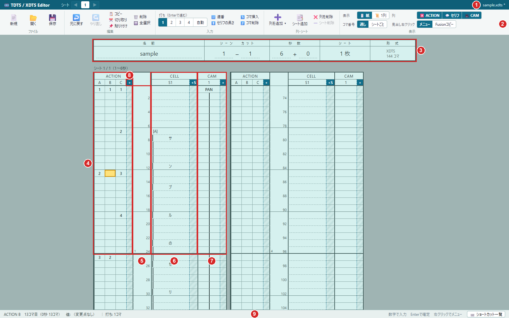
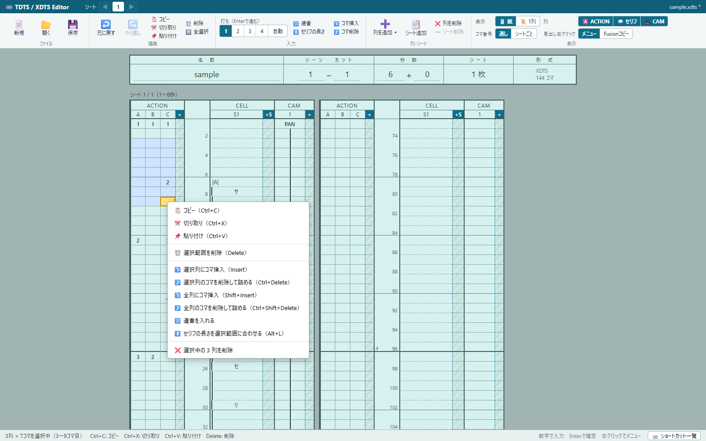

# TDTS / XDTS Editor

ブラウザだけで東映デジタルタイムシート（TDTS）とXDTSを開いて編集・保存できるエディタです。CLIP STUDIO PAINTの.clipファイルからタイムシートを直接取り込むこともできます。

## リポジトリの中身

| 場所 | 内容 |
| --- | --- |
| `06_Webエディタ_CLIP対応/index.html` | エディタ本体（このファイル1つで動く） |
| `05_CLIP抽出試作/tools/` | CLIP抽出の試作ツール（Python・JS） |
| `docs/images/` | このREADMEの画面写真 |

作品素材・引き継ぎ資料・XDTS仕様書PDFは `.gitignore` で除外し、手元だけに置いています。

## はじめに

`06_Webエディタ_CLIP対応/index.html` をChromeかEdgeにドラッグ＆ドロップするか、ダブルクリックで開けば使えます。インストールは不要で、ネットにつながっていなくても動きます。

- **扱えるファイル**：XDTS（.xdts）、東映デジタルタイムシート（.tdts）、CLIP STUDIO PAINTのファイル（.clip）
- **保存できる形式**：XDTS / TDTS（.clipから読み込んだものはXDTSとして保存）
- **ファイルの扱い**：読み込みも保存もすべてブラウザの中だけで行い、ファイルが外部に送られることはありません
- **フレームレート**：24fps固定で表示します

何もファイルを開いていないときは、空のタイムシート（6秒・1枚）が表示されます。そのまま書き込んで保存することもできます。

## 画面の見方

画面は上から「タイトルバー」「リボン」「シート」「ステータスバー」の4段です。シートの列の並びは、紙の東映タイムシートと同じです。

| 番号 | 名前 | 役割 |
| --- | --- | --- |
| 1 | タイトルバー | シート移動（◀ 1 2 3 ▶）と、開いているファイル名。未保存の変更があるとファイル名の後ろに * が付く |
| 2 | リボン | ファイル・編集・入力・列とシート・表示の操作ボタン。ボタンにマウスを乗せるとショートカットキーが出る |
| 3 | ヘッダー欄 | 名前、シーン／カット、秒数（尺）を入力する。シート枚数と形式は表示のみ |
| 4 | ACTION列 | 原画の番号を入れる列（A, B, C…） |
| 5 | コマ番号 | 偶数コマだけ番号を表示。1秒ごとに、その秒の最後のコマの左下へ小さく秒数が出る |
| 6 | CELL列 | セリフ列（S1, S2…）。TDTSでは動画のセル列（a, b…）もここに並ぶ |
| 7 | CAM列 | カメラワークの指示。**最初は非表示**（写真は表示に切り替えた状態） |
| 8 | ＋ボタン | そのグループに列を足す。下の斜線の帯をクリックしても同じ |
| 9 | ステータスバー | 選んでいるセルの列・コマ位置・入っている値と、今の打ち数。右端に「ショートカット一覧」ボタン |

1枚のシートは144コマ（6秒）で、左半分が1〜3秒、右半分が4〜6秒です。罫線は6コマごとに中線、24コマ（1秒）ごとに太線です。

## ファイルを開く・保存する

リボンの「開く」か、ファイルを画面にドラッグ＆ドロップすれば開けます。保存は「保存」で、ブラウザのダウンロードとしてファイルが出ます。

### CLIPファイルから取り込む

1. .clipファイルを開く
2. タイムラインが複数ある場合は一覧が出るので、編集するものを1本選ぶ（名前・コマ数・秒+コマ・fps付き）。タイムラインが1本ならそのまま開く
3. 以降の編集は、選んだタイムラインだけが対象
4. 保存すると「元のファイル名_タイムライン名.xdts」になる

取り込みの結果は、CLIP STUDIO PAINT EXが書き出すXDTSと同じ内容です（実作品のCLIPファイルのタイムライン4本で確認済み）。表示中のアニメーションフォルダーだけが対象で、S0〜S9という名前のフォルダーはセリフ列、カメラフォルダーはCAM列に入ります。

### 自動バックアップ

- 編集するたびに、ブラウザの中（ローカルストレージ）へ自動で保存します
- 保存しないまま閉じた場合、次に開いたとき「保存していない作業があります」と出ます。「復元する」で続きから再開、「破棄して新規で始める」で捨てます
- 復元した内容はまだファイルには保存されていないので、必ず「保存」してください
- バックアップはそのパソコンのそのブラウザにだけ残ります。別のブラウザやシークレットウィンドウでは復元できません

## 入力の基本

セルをクリックして数字を打ち、Enterで確定します。保存されるのは「値が変わるコマ」だけで、次の値までは同じ絵が続く扱いです（紙のタイムシートと同じ考え方）。

| 入力 | 意味 | 画面の表示 |
| --- | --- | --- |
| 数字・英字（1, 2, 2a など） | セル番号 | そのまま |
| 0 または × | 空セル（何も出さない） | × |
| - | 前の指示を継続 | 空欄 |
| ○ / ● | 中割予定 ／ 逆シート | ○ / ● |
| [話者]本文 | セリフ列で、話者と本文に分けて入る | 1コマ目に[話者]、本文は終わりのコマまで縦に並ぶ |

×に変わるのは単独の「0」だけです。「10」のように0を含む数字は、そのままの値になります。

### 入力の始め方

- **そのまま打つ**：セルを選んで数字や英字を打つと、すぐ入力が始まる（日本語入力がオフのとき）
- **Enter・F2・ダブルクリック**：入力欄を開く。すでに入っている値を直すときや、日本語を打つときはこちら
- **確定**：Enter（打ち数だけ下へ進む）、Shift+Enter（1コマ上へ）、別のセルをクリック
- **やめる**：Esc
- **消す**：Delete（そのコマの入力を消して1コマ下へ）

セリフやカメラの指示など日本語を打つときは、先にEnterかダブルクリックで入力欄を開いてから打ってください。日本語入力がオンのままいきなり打つと、入力が始まりません。

尺の外のグレーのセルは、選んだり入力したりできません。

### セリフの長さ

セリフは東映デジタルタイムシートと同じく縦に表示します。始まりのコマに[話者]、次のコマから終わりのコマまで本文を1文字ずつ均等に並べ、左に縦線、終わりのコマに横線が入ります。文字がマスより多いときは、1マスに2文字以上入ります。

- **範囲を選んでから入力**：セリフ列で始まりから終わりまで縦に選び、そのままセリフを打ってEnter。選んだ範囲がそのセリフの長さになる
- **長さを変える**：セリフの始まり（途中でも可）から新しい終わりまで縦に選び、リボン「入力」の「↕️ セリフの長さ」、右クリックメニュー、またはAlt+Lを押す。範囲の一番下が新しい終わりになる（伸ばす・縮めるの両方できる）
- 範囲を選ばずに入れたセリフは、1コマだけの長さになる
- 次のセリフを越えて伸ばすことはできない。範囲を選んで入力したときは、範囲の中にあった別のセリフは上書きされる

## 打ち数と連番

「打ち」を2にすると、入力してEnterを押すたびに2コマ下へ進みます。2コマ打ち・3コマ打ちの番号を、空けるコマ数を数えずに入れられます。

### 打ち数の選び方

リボンの「入力」グループの「打ち」から選びます。今の打ち数は画面下のステータスバーに常に出ています。

| 設定 | Enterで進むコマ数 | ショートカット |
| --- | --- | --- |
| 1〜4 | 1〜4コマ | Alt+1〜Alt+4 |
| 自動 | その列で直前に入れた値からの間隔と同じだけ | Alt+0 |

例：3コマ打ちで「1」Enter「2」Enter「3」Enter と打つと、1・4・7コマ目に入ります。自動の場合、5コマ目の次に9コマ目へ入れると、その次は13コマ目へ進みます。

矢印キーは打ち数に関係なく1コマずつ動きます。

### 連番

1. 番号を入れたい範囲を、縦に選ぶ（ドラッグかShift+矢印）
2. リボンの「🔢 連番」を押す（右クリックメニューにもあります）
3. 範囲の一番上から、打ち数ごとに 1, 2, 3… と入る

範囲の一番上にすでに数字があれば、その数字から続けて振ります。範囲の中に元々あった入力は置き換わります。セリフ列には入りません。

## 範囲選択・コピー・貼り付け・削除

Excelと同じ感覚で、複数の列・コマをまとめてコピー・貼り付け・削除できます。選んだ範囲は青くなり、ステータスバーに「3列 × 7コマを選択中」のように出ます。

- **選び方**：ドラッグ、Shift+クリック、Shift+矢印、Ctrl+A（全部）
- **コピー・切り取り・貼り付け**：Ctrl+C / Ctrl+X / Ctrl+V。リボンの「編集」グループや、右クリックメニューからも使える
- **貼り付ける場所**：選んだ範囲の左上が起点。コピー元で空だったコマは、貼り付け先でも空になる
- **1マスで埋める**：1マスだけコピーして範囲に貼ると、範囲全体が同じ値で埋まる
- **Excelなどからの貼り付け**：タブ区切りの表をそのまま貼れる。「0」は×、「-」は継続、「[話者]本文」はセリフとして読み込む
- **削除**：Deleteで、選んだ範囲の入力をまとめて消す

どの操作も、元に戻す（Ctrl+Z）1回で全部戻ります。対象は画面に見えている列だけで、非表示にした列には貼り付けも削除もしません。

## コマの挿入・削除

タイミングを直すときに、途中にコマを入れて後ろの入力をまとめて下へずらしたり、コマを抜いて上へ詰めたりできます。ずらすコマ数は、選んだ範囲の高さです（1マスなら1コマ）。

| 操作 | 対象 | キー |
| --- | --- | --- |
| コマ挿入 | 選んだ列 | Insert |
| コマ挿入 | 全列 | Shift+Insert |
| コマ削除（詰める） | 選んだ列 | Ctrl+Delete |
| コマ削除（詰める） | 全列 | Ctrl+Shift+Delete |

リボンの「入力」グループ（選んだ列）と、右クリックメニュー（選んだ列／全列）からも使えます。

- 挿入したコマには新しい入力がないので、直前の絵がその分長く続きます
- 挿入で入力が尺の外（グレー）に押し出されたときは、画面右下にそう表示します。尺は自動では延びないので、必要なら秒数を増やしてください
- MacのキーボードにはInsertキーがないので、リボンか右クリックメニューを使ってください

## 列とシートの操作

列もシートも、必要な分だけ足したり減らしたりできます。何も開いていないときは、ACTION「A」・セリフ「S1」・CAM「1」の1列ずつで始まります（CAMは最初は非表示）。

### 列

| やりたいこと | 方法 |
| --- | --- |
| 列を足す | 各グループ右端の青い「＋」（セリフは「＋S」）、その下の斜線の帯、またはリボンの「列を追加 ▾」 |
| 列を消す | 列の見出しにマウスを乗せて出る ▾ のメニュー、リボンの「列を削除」（選んでいる列を消す。範囲選択なら複数列まとめて）、右クリックメニュー |
| 名前を変える | 列の見出しをダブルクリック、または見出しのメニュー |

足した列の名前は、ACTIONがA, B, C…、セリフがS1, S2…、CAMが1, 2…の順で自動で付きます。列を消しても元に戻す（Ctrl+Z）で戻せます。

### シートと尺

- **シートを足す**：最後のシートの下の「＋ シート○を追加」、またはリボンの「シート追加」。1枚につき6秒（144コマ）尺が延びる
- **シートを減らす**：リボンの「シート削除」、または最後のシートの下の「− 最後のシートを削除」。そのシートの入力は消えずに隠れるだけ
- **1コマ単位で尺を合わせる**：ヘッダー欄の「秒数」に秒とコマを入れる（例：10 + 12）

尺より後のコマは、紙のタイムシートと同じくグレーになります（入力しないエリア）。

## 表示の切り替え

リボンの「表示」グループで、見た目だけを切り替えます。どれを切り替えても、保存される中身は変わりません。

| 項目 | 選択肢 | 内容 |
| --- | --- | --- |
| 表示 | 紙 ／ 1列 | 紙：東映タイムシートと同じ6秒/ページ、左右に分かれる。1列：全コマを縦に1列で並べる |
| コマ番号 | 通し ／ シートごと | 通し：前のシートから番号を引き継ぐ（2枚目は145から）。シートごと：各シートで1から振り直す（右半分は73から） |
| 列 | ACTION ／ セリフ ／ CAM（TDTSは CELL も） | 押すたびにその種類の列を表示・非表示。隠した列のボタンは取り消し線になる。CAMは最初は非表示 |
| 見出し右クリック | メニュー ／ Fusionコピー | ACTION／CELLの列見出しを右クリックしたときの動き。メニュー：メニューを開く。Fusionコピー：すぐFusion設定をコピーする（メニューは見出しの ▾ で開く） |

### 列を隠しているとき

- 各シートの上に黄色い札「非表示中: CAM」が出る。札を押すと全部の列が表示に戻る
- 隠した列のデータは消えず、保存にもそのまま入る
- 全部の列は隠せない
- 表示の設定はブラウザが覚えているので、開き直してもそのまま。一度も切り替えていないブラウザでは、CAMだけ隠した状態で始まる

### シートの移動

タイトルバーの「◀ 1 2 3 ▶」で移動します。今画面に出ているシートの番号が白く光ります。PageUp / PageDown（またはCtrl+↑↓）でも前後のシートへ移れ、選んでいる列とシート内の位置はそのまま保たれます。

## Fusion設定のコピー

ACTION列（TDTSではCELL列も）のタイミングを、DaVinci ResolveのFusionにそのまま貼れる設定としてコピーできます。

1. 列の見出し（A, B…）を右クリックし、「Fusion設定をコピー」を選ぶ（見出しの ▾ からも開ける）
2. Fusionのノード画面に貼り付ける

リボン「表示」の「見出し右クリック」を「Fusionコピー」にすると、ACTION／CELLの見出しを右クリックしただけでコピーされます。名前の変更や列の削除などのメニューは、見出しにマウスを乗せると出る ▾ から開きます。この設定はブラウザが覚えています。

セル番号が変わるコマにTimeStretcherのキーが、×（空セル）のコマにはマスクを切るキーが入ります。Fusion側のコマ番号は1から数えます。

## ショートカット一覧

同じ一覧は、画面右下の「ショートカット一覧」ボタンからも開けます。MacではCtrlを⌘、AltをOptionに読み替えてください。

| 分類 | キー | 動作 |
| --- | --- | --- |
| 入力 | 数字・英字 | 選んだセルにそのまま入力を始める |
| 入力 | Enter / F2 / ダブルクリック | 入力欄を開く（日本語はここから） |
| 入力 | Enter（入力中） | 確定して打ち数だけ下へ |
| 入力 | Shift+Enter ／ Esc | 確定して1コマ上へ ／ 入力をやめる |
| 入力 | Alt+1〜4 ／ Alt+0 | 打ち数を1〜4コマ ／ 自動にする |
| 入力 | 範囲を選んでセリフを入力 | 選んだ範囲がそのセリフの長さになる |
| 入力 | Alt+L | セリフの長さを選んだ範囲の下まで合わせる（伸ばす・縮める） |
| 選択 | 矢印 ／ Alt+↑↓ | 1コマずつ ／ 6コマずつ移動 |
| 選択 | Shift+矢印 ／ ドラッグ | 範囲選択 |
| 選択 | Ctrl+A | 全部選択 |
| 編集 | Ctrl+C / X / V | コピー ／ 切り取り ／ 貼り付け |
| 編集 | Delete | 選んだセル（範囲）の入力を消す |
| 編集 | Insert ／ Shift+Insert | 選んだ列 ／ 全列にコマ挿入 |
| 編集 | Ctrl+Delete ／ Ctrl+Shift+Delete | 選んだ列 ／ 全列のコマを削除して詰める |
| 編集 | Ctrl+Z ／ Ctrl+Y | 元に戻す ／ やり直し |
| 移動 | PageUp / PageDown（Ctrl+↑↓） | 前 ／ 次のシート |
| 移動 | Ctrl+Home ／ Ctrl+End | 最初 ／ 最後のシート |
| ファイル | Ctrl+O ／ Ctrl+S | 開く ／ 保存 |

## 注意点と、まだ確認できていないこと

- **TDTSは未検証**：動作は作ってありますが、実際のTDTSファイルではまだ試していません。最初に開くときは、元のファイルを別に取っておいてください
- **CAM列の中身**：CLIPから取り込んだとき、カメラの動きは入りません（列名だけ）。CLIP STUDIO PAINT EXの書き出しと同じ動きです
- **話者のないセリフ**：「[話者]」を付けずに入れたセリフは、本文だけで保存されます（前の人の続きという扱い）
- **保存形式の見た目**：保存したファイルは、中身は同じでも改行や字下げの付け方がCLIP STUDIO PAINTの書き出しと少し違います
- **自動バックアップの範囲**：残るのは最後に編集していた1件だけです。保存の代わりにはならないので、こまめに「保存」してください
- **日本語入力**：日本語入力がオンのままセルでいきなり打つと入力が始まりません。Enterかダブルクリックで入力欄を開いてから打ってください
- **対応ブラウザ**：Chromeで確認しています。Edge・Safari・Firefoxは未確認です。Safariで.clipを開くには、Safari 16.4以降が必要な見込みです
